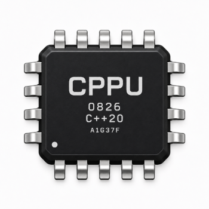

# cppu

A standalone emulator for the **Game Boy (DMG) Picture Processing Unit**, written in C++20.

cppu emulates only the PPU, not a whole Game Boy. It builds as a library that you can drop into a full Game Boy emulator or into a custom project that just needs Game Boy-style graphics. The PPU owns its VRAM, OAM and LCD registers. The host program drives the clock and connects those to its own memory map.

A small SDL2 frontend is included for viewing the output while developing.

> **Status:** early development. Working so far:
>
> - the memory and register interface
> - the mode timing, with LY advancing through OAM scan → drawing → HBlank on each visible line and VBlank on lines 144–153
> - VBlank and STAT interrupts
> - turning the LCD on and off
> - background rendering through the pixel FIFO: a dot-by-dot tile fetcher (GetTile → data low → data high → push) feeds the BG FIFO, and one pixel per dot is mapped through BGP into the framebuffer
>   - SCX/SCY scrolling with wraparound, including fine scroll (the first `SCX % 8` pixels of each line are dropped)
>   - both tile data modes (LCDC.4) and both BG tile maps (LCDC.3)
>   - LCDC.0 off blanks the background to white
> - mode 3 timing of 172 + (SCX % 8) dots, including the discarded first tile fetch of each line
>
> Not written yet: the window, objects (OAM scan doesn't select objects yet), and the extra mode 3 dots that the window and objects add.

## Goals

- **Accurate at the dot level.** `tick()` advances the PPU by one master clock cycle (one "dot"), so the mode timing (OAM scan → drawing → HBlank → VBlank) can be modeled faithfully.
- **Knows nothing about the bus.** The PPU has no idea where its memory and registers are mapped. VRAM and OAM are accessed by offset and registers by name, and the host translates its own addresses.
- **No dependencies in the library.** SDL2 is only used by the frontend.
- **Room to grow.** A Game Boy Color mode may be added later behind a flag.

## Layout

```
cppu/
├── CMakeLists.txt       # top-level build: the cppu library and options
├── include/cppu/        # public headers (what library users include)
│   └── ppu.hpp
├── src/                 # library implementation
│   └── ppu.cpp
├── frontend/            # SDL2 test harness (not part of the library)
│   ├── CMakeLists.txt
│   └── main.cpp
├── tests/               # CTest executables
│   ├── CMakeLists.txt
│   └── bg_render_test.cpp
└── docs/                # notes and hardware references
```

## Building

Requirements: CMake ≥ 3.21, a C++20 compiler, and SDL2 (frontend only).

```sh
# Debian/Ubuntu: sudo apt install cmake g++ libsdl2-dev
cmake -S . -B build
cmake --build build
./build/frontend/cppu_frontend
ctest --test-dir build --output-on-failure   # run the tests
```

### CMake options

| Option                    | Default                 | Description                          |
|---------------------------|-------------------------|--------------------------------------|
| `CPPU_BUILD_FRONTEND`     | `ON` when top-level     | Build the SDL2 frontend              |
| `CPPU_BUILD_TESTS`        | `ON` when top-level     | Build the tests                      |
| `CPPU_WARNINGS_AS_ERRORS` | `OFF`                   | Treat compiler warnings as errors    |

## Using cppu in another project

```cmake
add_subdirectory(external/cppu)   # frontend is off automatically when cppu is a subproject
target_link_libraries(my_emulator PRIVATE cppu::cppu)
```

Everything lives in `namespace cppu` and comes from a single header, `<cppu/ppu.hpp>`.

### Connecting the PPU to your memory map

cppu doesn't decode bus addresses. Your memory map sends the PPU's ranges to the matching calls. On a standard DMG memory map that looks like this:

```cpp
#include <cppu/ppu.hpp>

cppu::PPU ppu;   // owns 8 KiB VRAM, 160 B OAM and the LCD registers

std::uint8_t bus_read(std::uint16_t addr) {
    if (addr >= 0x8000 && addr <= 0x9FFF)
        return ppu.read_vram(addr - 0x8000);
    if (addr >= 0xFE00 && addr <= 0xFE9F)
        return ppu.read_oam(static_cast<std::uint8_t>(addr - 0xFE00));
    if (addr >= 0xFF40 && addr <= 0xFF4B)
        return ppu.read_register(static_cast<cppu::Reg>(addr - 0xFF40));
    // ...the rest of your memory map
}

// bus_write() mirrors this with write_vram / write_oam / write_register.
```

### Driving the clock

```cpp
// Call once per master clock cycle (4.194304 MHz).
ppu.tick();

// VBlank / STAT interrupts raised since the last call.
if_register |= ppu.take_interrupts();

// True once per frame, at the start of VBlank.
if (ppu.frame_ready()) {
    // One byte per pixel, shade 0 (lightest) to 3 (darkest),
    // row-major, kScreenWidth × kScreenHeight (160 × 144).
    const std::uint8_t* pixels = ppu.framebuffer();
}
```

The PPU starts with the LCD off (LCDC = 0), and `tick()` does nothing until LCDC bit 7 is set. On real hardware the boot ROM sets LCDC to 0x91. If your host skips the boot ROM, write that value yourself.

## API reference

### `cppu::PPU`

| Member | Description |
|---|---|
| `PPU()` | Creates a PPU with VRAM, OAM and all registers zeroed, except that the STAT mode bits start at 2 (OAM scan). |
| `void tick()` | Advances the PPU by one dot (one master clock cycle) and handles mode changes, LY and interrupts. Does nothing while the LCD is off. *Pixel output isn't implemented yet.* |
| `std::uint8_t read_vram(std::uint16_t offset) const` | Reads VRAM at `offset` (0x0000–0x1FFF). Out-of-range offsets return 0xFF. |
| `void write_vram(std::uint16_t offset, std::uint8_t value)` | Writes VRAM. Out-of-range writes are ignored. |
| `std::uint8_t read_oam(std::uint8_t offset) const` | Reads OAM at `offset` (0x00–0x9F). Out-of-range offsets return 0xFF. |
| `void write_oam(std::uint8_t offset, std::uint8_t value)` | Writes OAM. Out-of-range writes are ignored. Also the entry point for a host-driven OAM DMA transfer. |
| `std::uint8_t read_register(Reg reg) const` | Reads an LCD register (see below). |
| `void write_register(Reg reg, std::uint8_t value)` | Writes an LCD register (see below). |
| `std::uint8_t take_interrupts()` | Returns the interrupts raised since the last call as `kIntVBlank \| kIntStat` bits, then clears them. OR the result into your IF register. The STAT interrupt fires only on a rising edge of the combined STAT condition, as on hardware. |
| `bool frame_ready()` | Returns `true` once per frame, after VBlank begins, then `false` until the next VBlank. |
| `const std::uint8_t* framebuffer() const` | The current output image (see [Driving the clock](#driving-the-clock)). |

VRAM and OAM are not yet locked during modes 2 and 3. For now, CPU access always succeeds.

### Registers: `cppu::Reg`

Each enumerator's value is the register's offset from 0xFF40, so a host with the standard memory map can convert with `static_cast<cppu::Reg>(addr - 0xFF40)`.

| `Reg` | DMG address | Read | Write |
|---|---|---|---|
| `LCDC` | 0xFF40 | value | stored as-is. Clearing bit 7 resets LY to 0 and the mode to 0. Setting it starts a new frame at line 0 |
| `STAT` | 0xFF41 | bit 7 reads 1; bit 2 reflects LY == LYC | only bits 3–6 (interrupt selects) are writable |
| `SCY`, `SCX` | 0xFF42–43 | value | stored as-is |
| `LY` | 0xFF44 | current scanline | ignored (read-only) |
| `LYC` | 0xFF45 | value | stored as-is |
| `DMA` | 0xFF46 | 0xFF | ignored. The host performs OAM DMA itself through `write_oam` |
| `BGP`, `OBP0`, `OBP1` | 0xFF47–49 | value | stored as-is |
| `WY`, `WX` | 0xFF4A–4B | value | stored as-is |

### Register bit masks

For decoding register values, e.g. in a debugger:

| Constant | Bit | Meaning |
|---|---|---|
| `lcdc::kEnable` | 7 | LCD and PPU on |
| `lcdc::kWndTileMap` | 6 | Window tile map: 0 = VRAM+0x1800, 1 = VRAM+0x1C00 |
| `lcdc::kWndEnable` | 5 | Window on |
| `lcdc::kBgWndTileData` | 4 | BG/window tile data: 0 = VRAM+0x0800 (signed), 1 = VRAM+0x0000 (unsigned) |
| `lcdc::kBgTileMap` | 3 | BG tile map: 0 = VRAM+0x1800, 1 = VRAM+0x1C00 |
| `lcdc::kObjSize` | 2 | Objects: 0 = 8×8, 1 = 8×16 |
| `lcdc::kObjEnable` | 1 | Objects on |
| `lcdc::kBgWndEnable` | 0 | BG and window on |
| `stat::kLycIntSelect` | 6 | STAT interrupt on LY == LYC |
| `stat::kMode2IntSelect` | 5 | STAT interrupt on mode 2 |
| `stat::kMode1IntSelect` | 4 | STAT interrupt on mode 1 |
| `stat::kMode0IntSelect` | 3 | STAT interrupt on mode 0 |
| `stat::kLycEqualsLy` | 2 | LY == LYC (read-only) |
| `stat::kModeMask` | 1–0 | Current PPU mode (read-only) |

`PPU` also has convenience getters that return these bits already decoded: `lcdc_enable()`, `lcdc_wnd_enable()`, `lcdc_tile_map_area()` (window tile map), `lcdc_bg_wnd_tile_data_area()`, `lcdc_bg_tile_map_area()`, `lcdc_obj_size()`, `lcdc_obj_enable()`, `lcdc_bg_wnd_enable()`, `stat_int_mode_0()`, `stat_int_mode_1()`, `stat_int_mode_2()`, `stat_int_mode_lyc()`, `stat_lyc()` and `stat_ppu_mode()` (returns 0–3).

### Constants

| Constant | Value | |
|---|---|---|
| `kScreenWidth`, `kScreenHeight` | 160, 144 | Framebuffer size in pixels |
| `kDotsPerLine` | 456 | |
| `kLinesPerFrame` | 154 | |
| `kDotsPerFrame` | 70,224 | `tick()` calls per frame |
| `kOamScanDots` | 80 | Length of mode 2 (OAM scan) |
| `kIntVBlank`, `kIntStat` | 0x01, 0x02 | Bits returned by `take_interrupts()`, in IF-register order |

The API may still change as the PPU takes shape.

## Tests

The tests are plain executables registered with CTest; they're built by default when cppu is the top-level project (`CPPU_BUILD_TESTS`).

```sh
cmake --build build
ctest --test-dir build --output-on-failure
```

| Test        | What it checks |
|-------------|----------------|
| `bg_render` | Renders a frame from a known tile pattern and compares every pixel against expected colors, across no scroll, fine scroll, wraparound and signed tile data. Also checks that mode 3 lasts 172 + (SCX % 8) dots. |

## Timing reference (DMG)

| Quantity          | Value                         |
|-------------------|-------------------------------|
| Master clock      | 4,194,304 Hz                  |
| Dots per scanline | 456                           |
| Scanlines / frame | 154 (144 visible + 10 VBlank) |
| Dots per frame    | 70,224 (~59.73 Hz)            |
| Mode 2 (OAM scan) | 80 dots                       |
| Mode 3 (drawing)  | 172–289 dots (variable)       |
| Mode 0 (HBlank)   | the rest of the 456 dots      |
| Mode 1 (VBlank)   | lines 144–153                 |

## References

- [Pan Docs](https://gbdev.io/pandocs/): the standard Game Boy technical reference
- [The Ultimate Game Boy Talk (33c3)](https://www.youtube.com/watch?v=HyzD8pNlpwI): a great overview of the PPU's FIFO
- [GBEDG: PPU](https://hacktix.github.io/GBEDG/ppu/): an emulator developer's guide to the PPU
- [dmg-acid2](https://github.com/mattcurrie/dmg-acid2): a PPU accuracy test ROM
