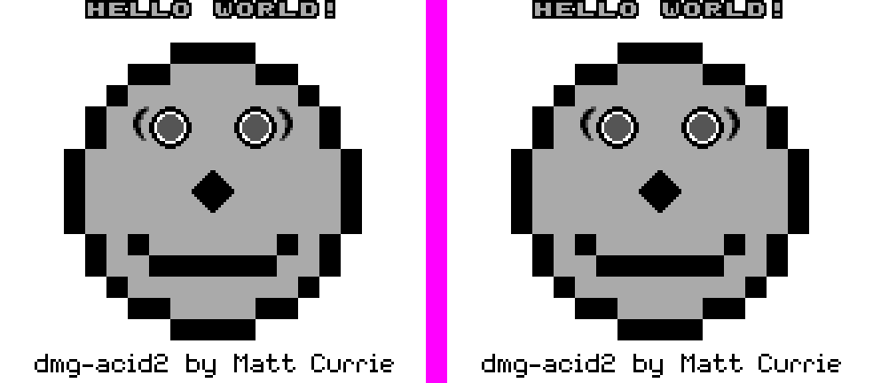

# dmg-acid2 test host

Runs Matt Currie's [dmg-acid2](https://github.com/mattcurrie/dmg-acid2) PPU test ROM with cppu as the PPU. cppu is only a PPU, so this tool borrows the rest of a Game Boy (CPU, timers, interrupts, memory map) from [Peanut-GB](https://github.com/deltabeard/Peanut-GB), a small single-header C99 emulator, with its own PPU switched off.



## Building and running

Needs SDL2. The tool is off by default:

```sh
cmake -S . -B build -DCPPU_BUILD_ACID2=ON
cmake --build build --target cppu_acid2
```

Download `dmg-acid2.gb` from the [dmg-acid2 releases](https://github.com/mattcurrie/dmg-acid2/releases) (the repo's `.gitignore` excludes `*.gb`, so keep it anywhere), then:

```sh
./build/tools/acid2/cppu_acid2 path/to/dmg-acid2.gb                              # window; Esc quits
./build/tools/acid2/cppu_acid2 path/to/dmg-acid2.gb --frames 60 --out acid2.bmp  # headless screenshot
```

Compare the result with [the reference image](https://github.com/mattcurrie/dmg-acid2/blob/master/img/reference-dmg.png). The tool uses the same four grays as the reference (white, 0xAA, 0x55, black), so a pass is an exact match. The test finishes drawing within a few frames. If something's off, the [failure examples](https://github.com/mattcurrie/dmg-acid2#failure-examples) in the dmg-acid2 README show which feature each kind of difference points to.

## How it fits together

| File | Role |
|---|---|
| `third_party/peanut_gb/peanut_gb.h` | Peanut-GB, vendored and patched (below) |
| `third_party/peanut_gb/cppu-integration.patch` | The patch, as a diff against upstream |
| `peanut_host.c` | Hosts Peanut-GB: ROM loading, and the PPU hooks implemented on cppu, including OAM DMA |
| `cppu_bridge.h` / `.cpp` | A C interface to one `cppu::PPU`, since Peanut-GB is C |
| `main.cpp` | Loads the ROM, runs frames, shows or saves cppu's framebuffer |

Each instruction Peanut-GB executes reports how many T-cycles it took; `peanut_host.c` ticks cppu that many times, runs OAM DMA alongside (one byte every 4 dots via `write_oam_dma()`, as in the main README's [OAM DMA](../../README.md#oam-dma) example), and ORs `take_interrupts()` into IF.

## Vendored Peanut-GB

- Upstream: <https://github.com/deltabeard/Peanut-GB>, commit `d0bcca771c83a2638c93a9ae61f3d51f226dc905`, file `peanut_gb.h`
- SHA-256 of the unmodified upstream file: `cf7777068492474d084f7dca0b00724d4dcdeab7f9a6c91a5d3a82e60d1cf728`
- License: MIT (in the header's opening comment; parts are from SameBoy, also MIT)

### Our patch

All changes sit behind a new `PEANUT_GB_EXTERNAL_PPU` switch, which defaults to 0, so with it off the header behaves like upstream. Each change is marked with a `cppu:` comment. With the switch on:

1. VRAM (0x8000–0x9FFF), OAM (0xFE00–0xFE9F) and the LCD registers (0xFF40–0xFF4B, including DMA) are read and written through `gb_ext_ppu_read()` / `gb_ext_ppu_write()`, which the front-end provides.
2. The LCD timing block at the end of `__gb_step_cpu()` is replaced by a call to `gb_ext_ppu_tick()` with the instruction's cycle count. The front-end raises PPU interrupts in IF and sets `gb_frame`.
3. HALT no longer fast-forwards to the next LCD event (it used Peanut-GB's own LCD state). It steps 4 cycles at a time, so cppu's interrupts wake it on time.

To update Peanut-GB: download the new `peanut_gb.h`, apply `cppu-integration.patch` (`patch -p1 < cppu-integration.patch` in its directory), fix any rejects by hand, regenerate the patch, and update the commit and hash above.

## Limitations

These don't matter for dmg-acid2, which is designed to pass with a simple line-based renderer, but they would for timing-sensitive tests:

- **cppu is ticked after each instruction**, not interleaved with the instruction's individual memory accesses, so a CPU read or write lands up to an instruction's length early relative to the PPU.
- **The CPU isn't restricted to HRAM during OAM DMA.**
- **Only plain ROM cartridges are wired up** (no cartridge RAM), and there's no joypad input or sound.
